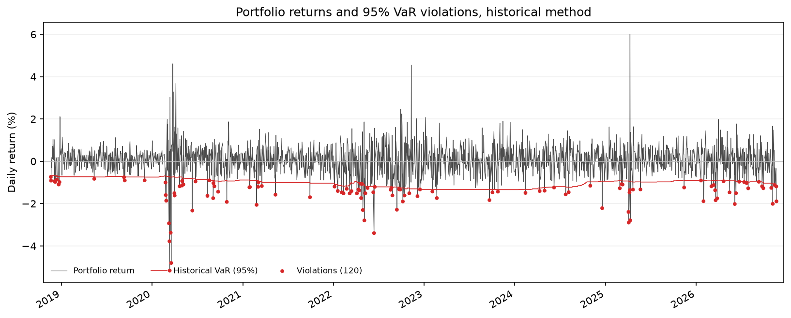
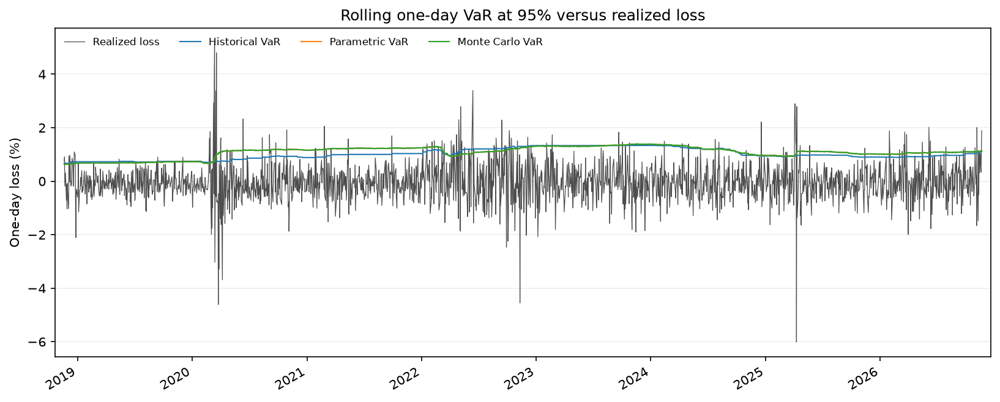
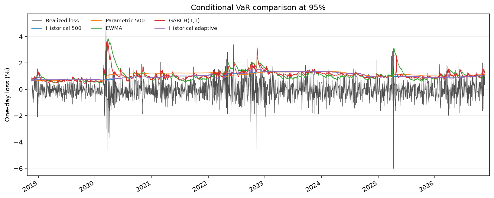
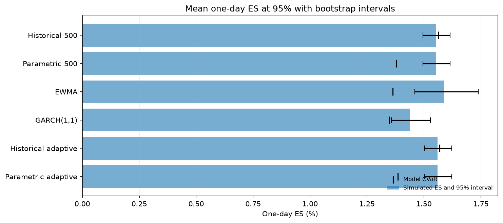

# risk-lab

One-day Value at Risk (VaR) and Conditional Value at Risk (CVaR) for a fixed
three-asset portfolio, with rolling backtests at 95% and 99%, coverage tests
and a reproducible data snapshot.

Author: Iker Abad (GitHub: [IkerAbad](https://github.com/IkerAbad))

License: MIT, Copyright (c) 2026 Iker Abad.

The repository is self-contained. The price snapshot, the figures and the
result tables are committed, so the tests and the figure pipeline run without
network access.

## Project layout

```text
risk-lab/
├── data/
│   ├── prices.csv
│   ├── prices.sha256
│   └── fresh/
│       ├── prices_2026-11-23.csv
│       └── prices_2026-11-23.sha256
├── docs/
│   ├── methodology.md
│   ├── results.md
│   ├── results_conditional.md
│   ├── results_fresh.md
│   ├── api.md
│   ├── architecture.md
│   ├── decisions.md
│   ├── data_dictionary.md
│   ├── data_quality.md
│   ├── glossary.md
│   ├── reproducibility.md
│   ├── troubleshooting.md
│   ├── checksums.sha256
│   ├── fig1_returns_violations.png
│   ├── fig2_rolling_var.png
│   ├── fig3_conditional_var.png
│   ├── fig4_es_ci.png
│   ├── full_sample_risk.csv
│   ├── backtest_summary.csv
│   ├── backtest_series.csv
│   ├── sensitivity.csv
│   ├── violations_by_year.csv
│   ├── conditional_summary.csv
│   ├── conditional_dm.csv
│   ├── conditional_stress.csv
│   ├── conditional_es.csv
│   ├── conditional_series_95.csv
│   └── fresh/
│       ├── tables.md
│       ├── comparison_fresh_95.csv
│       ├── comparison_fresh_99.csv
│       ├── comparison_common_95.csv
│       ├── comparison_common_99.csv
│       ├── winners.csv
│       ├── main_comparison.csv
│       └── garch_diagnostics_summary.csv
├── scripts/
│   ├── download_data.py
│   ├── fetch_live_data.py
│   ├── make_figures.py
│   ├── make_extended_analysis.py
│   ├── make_conditional_analysis.py
│   ├── make_fresh_analysis.py
│   ├── data_quality.py
│   ├── mutation_smoke.py
│   ├── update_checksums.py
│   └── check_all.py
├── src/risk_lab/
│   ├── data.py
│   ├── var.py
│   ├── backtest.py
│   ├── conditional.py
│   ├── comparison.py
│   ├── stats.py
│   ├── plots.py
│   └── py.typed
├── tests/
│   ├── test_data.py
│   ├── test_var.py
│   ├── test_backtest.py
│   ├── test_conditional.py
│   ├── test_comparison.py
│   ├── test_stats.py
│   ├── test_plots.py
│   ├── test_download.py
│   ├── test_live_data.py
│   ├── test_fresh_analysis.py
│   ├── test_scripts.py
│   ├── test_properties.py
│   ├── test_packaging.py
│   └── test_docs.py
├── .github/
│   ├── workflows/
│   │   ├── ci.yml
│   │   ├── codeql.yml
│   │   ├── dependency-review.yml
│   │   ├── release.yml
│   │   └── scorecard.yml
│   ├── CODEOWNERS
│   ├── ISSUE_TEMPLATE/
│   │   └── bug_report.yml
│   ├── pull_request_template.md
│   └── dependabot.yml
├── .pre-commit-config.yaml
├── constraints.txt
├── pyproject.toml
├── README.md
├── CONTRIBUTING.md
├── CHANGELOG.md
├── CITATION.cff
├── SECURITY.md
└── LICENSE
```

## Data

The portfolio holds three US ETFs with fixed long-only weights:

| Ticker | Exposure | Weight |
|---|---|---:|
| SPY | US large-cap equities | 0.50 |
| TLT | US long-term Treasuries | 0.35 |
| GLD | Gold | 0.15 |

The weights are a simple allocation across equity, duration and gold. They were
not optimized on the sample. The portfolio is rebalanced to the target weights
every day and pays no transaction costs.

`data/prices.csv` contains 2,513 daily adjusted closes from 2016-11-22 to
2026-11-20. Returns are computed from consecutive rows, so the first return is
2016-11-23 and the sample has 2,512 returns. The three series are aligned on
the intersection of US trading days. Missing calendar dates are non-trading
days.

SHA-256 of the committed CSV, also stored in `data/prices.sha256`:

```text
d33a038e9b4460468ca195b2f7c9c3374ce062d1ff7cf75280f6a8e300e2e3a1
```

The code is MIT. The price data is included for reproducibility and remains
subject to the data vendor's terms.

The canonical file is never overwritten. A refresh writes a dated copy to
`data/fresh/prices_<date>.csv` with its own SHA-256. `scripts/fetch_live_data.py`
verifies the canonical checksum before and after the download.

### Source and provenance

`scripts/download_data.py` tries Stooq first, using the symbols `spy.us`,
`tlt.us` and `gld.us`. On 2026-11-22 the Stooq CSV endpoint returned
`Access denied` from the author's network, both from Python and from a normal
browser. The committed snapshot was therefore built from Yahoo Finance
adjusted closes. The adjusted close accounts for splits and dividends. The
downloader keeps the Stooq path for networks where the endpoint works and
falls back to Yahoo only when Stooq fails. The Stooq path uses its `Close`
column as provided. The committed results use the Yahoo adjusted close.

The command used for the committed file was:

```bash
python scripts/download_data.py --start 2016-11-22 --end 2026-11-22 --out data/prices.csv
```

The file is versioned. Re-running the downloader on a later date moves the
sample window and changes every result. Yahoo also revises adjusted closes
when dividend information changes, so a fresh download of the same date range
can differ from the committed snapshot in the last decimal places. The
committed CSV and its SHA-256 are the reference for every number in this
README.

## Methods

Let R_t be the daily portfolio return and L_t = -R_t the daily loss. All VaR
and CVaR figures in this repository are reported as positive losses. A VaR of
0.0103 means a one-day loss of 1.03% of portfolio value. The return quantile
is -VaR.

The main analysis uses α = 0.95 and a 500-day window. The extended analysis
uses α = 0.99 and windows of 250, 500 and 750 days.

### Historical

The empirical quantile with linear interpolation is Q_{1-α}. The estimators
are:

```text
VaR_t  = -Q_{1-α}(R_{t-500}, ..., R_{t-1})
CVaR_t = -mean(R_s | R_s <= Q_{1-α})
```

The CVaR is the negative mean of the returns in the empirical tail at or below
the quantile. No distributional assumption is made.

### Parametric

With μ_t and σ_t the sample mean and sample standard deviation of the window
(`ddof=1`), and z_p = Φ^{-1}(p):

```text
VaR_t  = -(μ_t + σ_t z_{1-α})
CVaR_t = -μ_t + σ_t φ(z_{1-α}) / (1 - α)
```

The CVaR expression is the closed-form mean of the normal loss tail. It is
not an average over a finite sample.

### Monte Carlo

The window gives an asset mean vector μ_t and a sample covariance matrix Σ_t
(`ddof=1`). The simulation draws 100,000 scenarios:

```text
R^(s) = μ_t + C_t z^(s),   z^(s) ~ N(0, I),   C_t C_t' = Σ_t
R_p^(s) = w' R^(s)
VaR_t  = -Q_{1-α}(R_p^(s))
CVaR_t = -mean(R_p^(s) | R_p^(s) <= Q_{1-α})
```

`C_t` is the lower Cholesky factor of Σ_t. The seed is fixed at 42. In the
rolling backtest the seed for forecast day t is 42 plus the integer position
of t in the return array, so every day has a deterministic and independent
stream. The committed results use 100,000 scenarios per day.

### Conditional volatility

The comparison adds four models that let the volatility change over time. They
were fixed in `docs/methodology.md`, section 10, before the results were
computed.

EWMA variance with λ = 0.94 and zero mean:

```text
v_t = λ v_{t-1} + (1 - λ) R_{t-1}^2
```

The first variance is the sample variance of the first 500 returns. The
one-day forecast is v_t after the last return in the window.

GARCH(1,1) with a constant mean:

```text
R_t   = μ + ε_t,   ε_t = σ_t z_t,   z_t ~ N(0, 1)
σ²_t  = ω + α ε²_{t-1} + β σ²_{t-1}
```

The parameters are estimated by Gaussian quasi-maximum likelihood on the 500
returns before the forecast date, with the constraint α + β < 1. The fit is
repeated every 21 days and the parameters are held fixed in between. The
starting values are 5% of the window variance for ω and 0.05, 0.90 for α, β.
If the optimizer fails, the model falls back to α = 0.05 and β = 0.90.

The adaptive window uses 250 days when the 20-day realized volatility divided
by the 250-day realized volatility is at least 1.25, and 500 days otherwise.
It is applied to the historical and the parametric estimator.

Conditional VaR and CVaR use the conditional mean and volatility:

```text
VaR_t  = -(μ_t + σ_t z_{1-α})
CVaR_t = -μ_t + σ_t φ(z_{1-α}) / (1 - α)
```

The expected shortfall of the historical and adaptive models is estimated by
filtered historical simulation. The standardized residuals of the window,
`(R_s - μ_s) / σ_s`, are resampled 10,000 times with replacement, scaled by
the one-day volatility forecast and averaged over the tail. The seed is 42
plus the forecast position.

## Backtest design

The backtest is walk-forward:

- The first 500 returns form the initial estimation window.
- For each forecast date t, the model uses only returns from t-500 to t-1.
- The forecast is one day ahead. The estimation window rolls forward one day.
- A violation occurs when the realized loss is strictly greater than VaR.
- The sample has 2,012 forecasts, from 2018-11-19 to 2026-11-20.
- The expected number of violations at 95% is 2,012 × 0.05 = 100.6.

### Kupiec test

Let N be the number of forecasts, x the number of violations and p0 = 1 - α.
Under the null, the violation probability is p0. The likelihood-ratio
statistic is:

```text
LR_uc = -2 ln[ (1-p0)^(N-x) p0^x / ((1-x/N)^(N-x) (x/N)^x) ]
```

Under the null, LR_uc is asymptotically χ²(1). The p-value is
`chi2.sf(LR_uc, 1)`. The zero-violation and all-violation cases are handled as
limits.

### Christoffersen independence test

Let n_ij be the number of transitions from state i on one day to state j on
the next day, where 0 means no violation and 1 means violation. Define:

```text
π01 = n01 / (n00 + n01)
π11 = n11 / (n10 + n11)
π   = (n01 + n11) / (n00 + n01 + n10 + n11)

LR_ind = -2 ln[ (1-π)^(n00+n10) π^(n01+n11)
                / ((1-π01)^n00 π01^n01 (1-π11)^n10 π11^n11) ]
```

Under the null, LR_ind is asymptotically χ²(1). The p-value is
`chi2.sf(LR_ind, 1)`. If one of the two states never follows a transition,
the test is undefined and the implementation returns a NaN p-value instead of
inventing one.

### Christoffersen conditional coverage test

The joint test combines correct unconditional coverage and independence:

```text
LR_cc = LR_uc + LR_ind
```

Under the null, LR_cc is asymptotically χ²(2). The p-value is
`chi2.sf(LR_cc, 2)`. If the independence component is undefined, the joint test
is undefined and the p-value is NaN.

All p-values are computed with SciPy. None are typed in from a table.

## Results

### Full-sample estimates

These are descriptive estimates on the 2,512 returns. They are not the
backtest.

| Method | VaR 95% | CVaR 95% |
|---|---:|---:|
| Historical | 1.031% | 1.574% |
| Parametric | 1.068% | 1.349% |
| Monte Carlo | 1.076% | 1.353% |

The empirical CVaR is 0.225 percentage points above the normal CVaR. The
empirical VaR is slightly lower than the normal VaR. This combination is what
a fat left tail looks like in this sample: the 5% quantile is close to the
normal one, while the average loss beyond it is larger.

### Rolling backtest

| Method | Violations | Expected | Rate | Kupiec LR | Kupiec p | Christoffersen LR | Christoffersen p | Conditional p |
|---|---:|---:|---:|---:|---:|---:|---:|---:|
| Historical | 120 | 100.6 | 5.96% | 3.719 | 0.0538 | 9.865 | 0.00168 | 0.00112 |
| Parametric | 114 | 100.6 | 5.67% | 1.805 | 0.1791 | 12.127 | 0.000497 | 0.000944 |
| Monte Carlo | 114 | 100.6 | 5.67% | 1.805 | 0.1791 | 12.127 | 0.000497 | 0.000944 |

The Monte Carlo and parametric rows are identical after rounding because both
models assume the same multivariate normal distribution. The Monte Carlo
estimate is a numerical approximation of the parametric one. The largest
absolute difference between their daily VaR estimates is 0.000202 in return
units, or 0.0202 percentage points, and the violation flags differ on 2 of the
2,012 days. Those two differences cancel in the totals and do not change the
transition counts.

Interpretation:

- Kupiec does not reject correct unconditional coverage for any method at the
  5% level. The historical method is borderline at p = 0.0538 and its observed
  rate is 5.96%, above the nominal 5%.
- Christoffersen rejects independence for all three methods. The p-values are
  0.00168, 0.000497 and 0.000497. The violations cluster in time, which is
  consistent with the models reacting too slowly to changes in volatility.
- The joint conditional coverage test also rejects all three methods, with
  p-values 0.00112, 0.000944 and 0.000944.
- No method passes all three tests. The normal models pass unconditional
  coverage but fail independence and conditional coverage. The historical
  model is close to failing unconditional coverage and also fails independence
  and conditional coverage.
- The historical method has the lowest average rolling VaR, 1.016% against
  1.091% for the normal models. That is consistent with its six more
  violations.
- The historical CVaR is higher on average, 1.564% against 1.378% for the
  normal models. The normal models underestimate the size of the tail losses.

The independence rejections survive a Bonferroni correction for the six
Kupiec and independence tests at the 5% level, whose threshold is 0.00833.
They do not disappear after rounding.

### Extended analysis

The full tables are in [docs/results.md](docs/results.md). The key results:

- At 99% with the 500-day window, the normal model has 40 violations against
  20.1 expected. Kupiec p = 8.64e-05. The historical model has 24 against 20.1,
  Kupiec p = 0.3988, but Christoffersen p = 0.00227. The normal tail is too
  thin.
- At 95%, the 750-day normal model is the only combination that passes
  Kupiec, Christoffersen and conditional coverage. It has 96 violations
  against 88.1 expected, Kupiec p = 0.3944, Christoffersen p = 0.1040 and
  conditional p = 0.1856. The 250-day and 500-day normal models fail
  independence. The window length matters.
- The yearly table shows the clustering. In 2022, the historical method has
  31 violations out of 251 forecasts (12.35%) and the normal model 37 (14.74%).
  In 2023, all methods have 5 out of 250 (2.00%).
- The 750-day pass is exploratory. It was selected after looking at the
  results and is not corrected for multiple testing.

The yearly counts are in `docs/violations_by_year.csv`. The full sensitivity
table is `docs/sensitivity.csv`.

### Conditional volatility comparison

The protocol for this comparison is section 10 of
[docs/methodology.md](docs/methodology.md), dated 2026-11-23 and committed
before the results were computed. It fixes the six models, the EWMA λ, the
GARCH settings, the adaptive rule, the quantile loss, the 15 pairwise
Diebold-Mariano tests with Newey-West lags of 5, the Holm correction, the
block bootstrap and the winner rule. The full tables are in
[docs/results_conditional.md](docs/results_conditional.md).

The evaluation period is the same 2,012 one-day forecasts from 2018-11-19 to
2026-11-20. The quantile loss is the asymmetric loss for the return quantile
`q_t = -VaR_t` with `τ = 0.05`, averaged over the sample. A lower value is
better.

| Model | Violations | Expected | Rate | Kupiec p | Christoffersen p | Conditional p | Mean loss (bp) | Rank |
|---|---:|---:|---:|---:|---:|---:|---:|---:|
| GARCH(1,1) | 102 | 100.6 | 5.07% | 0.8864 | 0.3916 | 0.6858 | 7.83 | 1 |
| EWMA | 102 | 100.6 | 5.07% | 0.8864 | 0.9729 | 0.9893 | 8.08 | 2 |
| Historical 500 | 120 | 100.6 | 5.96% | 0.0538 | 0.00168 | 0.00112 | 8.59 | 3 |
| Parametric adaptive | 109 | 100.6 | 5.42% | 0.3963 | 0.00617 | 0.01642 | 8.62 | 4 |
| Historical adaptive | 116 | 100.6 | 5.77% | 0.1237 | 0.00255 | 0.00323 | 8.63 | 5 |
| Parametric 500 | 114 | 100.6 | 5.67% | 0.1791 | 0.000497 | 0.000944 | 8.63 | 6 |

At 95%, conditional volatility fixes the independence failure. GARCH and EWMA
pass Kupiec, Christoffersen and conditional coverage. The fixed and adaptive
historical and parametric models still fail independence. The adaptive window
changes little: the historical model moves from 120 to 116 violations and the
parametric model from 114 to 109, with the same mean loss after rounding.

The winner rule was fixed in the protocol: the best model wins only if the
Holm-adjusted Diebold-Mariano p-value against the second-best is below 0.05.
GARCH has the lowest mean loss and EWMA is second. The Holm-adjusted p-value
for EWMA against GARCH is 0.7039, so the rule returns **no clear winner**. The
raw p-value is 0.0640. The Holm correction over the 15 pairs raises the
comparison against the fixed models from raw p-values of 0.036 and 0.022 to
0.435 and 0.309. None of the pairwise differences survives the correction.

At 99%, GARCH has 36 violations against 20.1 expected, Kupiec p = 0.00136,
and EWMA has 42, Kupiec p = 0.000019. The historical models have 27 and 24
violations, closer to 20.1, but fail independence. No model passes both tests
at 99%. The lower mean loss of GARCH at 99% (2.38 bp against 2.56 bp for EWMA)
does not make it a valid 99% model: the normal conditional tail is still too
thin.

The expected shortfall is in `docs/conditional_es.csv`. At 95%, the mean
simulated ES is 1.4394% for GARCH, 1.5888% for EWMA and 1.5531% for the
historical models. The block-bootstrap intervals overlap. At 99%, GARCH has a
lower simulated ES (2.0611%) than EWMA (2.3208%). The GARCH interval overlaps
the EWMA interval but not the historical intervals. GARCH also has too many VaR
violations, so the lower tail mean is not evidence of a better model.

The stress-year ranking is mixed. GARCH has the lowest mean loss in 2020,
EWMA in 2022, and the parametric models in 2026. No model dominates the three
years.

### Fresh data

The committed snapshot is frozen. `scripts/fetch_live_data.py` downloads a
dated copy to `data/fresh`, checks the canonical checksum before and after,
validates the schema and writes a checksum for the new file. It never writes
to `data/prices.csv`.

```bash
python scripts/fetch_live_data.py
python scripts/make_fresh_analysis.py
```

The committed fresh file is `data/fresh/prices_2026-11-23.csv`: 2,514 rows from
2016-11-22 to 2026-11-23. It adds one trading day. Yahoo also revised the
overlapping adjusted closes by at most `1.37e-04%` (TLT), enough to move the
GARCH optimizer but not the historical or EWMA estimates.

| Model | Mean loss snapshot (bp) | Mean loss fresh (bp) | Rank snapshot | Rank fresh |
|---|---:|---:|---:|---:|
| GARCH(1,1) | 7.83 | 8.71 | 1 | 6 |
| EWMA | 8.08 | 8.09 | 2 | 1 |
| Historical 500 | 8.59 | 8.60 | 3 | 2 |
| Parametric adaptive | 8.62 | 8.63 | 4 | 3 |
| Historical adaptive | 8.63 | 8.64 | 5 | 4 |
| Parametric 500 | 8.63 | 8.64 | 6 | 5 |

The point-estimate winner changes from GARCH(1,1) to EWMA at 95% and at 99%.
The pre-registered rule still returns **no clear winner**: the Holm-adjusted
Diebold-Mariano p-value is 1.0000 at both levels. The common-period run, which
cuts the fresh prices at 2026-11-20, gives the same ranks, so the change comes
from the price revisions and not from the extra day.

The GARCH fits explain the change. The canonical run has two failed fits and
uses the fallback. The fresh run reports success on every fit, but three fits
have `alpha < 1e-8` and one has `beta > 0.99`. The worst fit puts `omega` at
159 times the sample variance. The GARCH first place in `v1.0.0` was within
optimizer noise. The full comparison, the ES tables and the diagnostic are in
[docs/results_fresh.md](docs/results_fresh.md).

### Figures



Figure 1: daily portfolio returns and the rolling historical VaR at 95%. Red
dots mark the 120 violations. The VaR line is the negative of the positive VaR
estimate.



Figure 2: realized daily loss against the rolling VaR from the three methods.
The historical VaR is usually the lowest of the three. The parametric and Monte
Carlo lines are nearly identical.



Figure 3: realized daily loss against the GARCH, EWMA, historical 500,
parametric 500 and adaptive historical VaR at 95%.



Figure 4: mean simulated ES at 95% for the six models, with 95% moving block
bootstrap intervals. The black markers are the model CVaR.

## Documentation

- [docs/methodology.md](docs/methodology.md): estimation and testing details.
- [docs/results.md](docs/results.md): full tables for 95%, 99%, windows and
  calendar years.
- [docs/results_conditional.md](docs/results_conditional.md): the
  pre-registered conditional volatility comparison, expected shortfall with
  bootstrap intervals and stress years.
- [docs/results_fresh.md](docs/results_fresh.md): the dated fresh-data
  comparison, the winner change and the GARCH fit diagnostics.
- [docs/api.md](docs/api.md): public functions, arguments and error conditions.
- [docs/architecture.md](docs/architecture.md): module responsibilities, data
  flow and invariants.
- [docs/decisions.md](docs/decisions.md): the main design decisions and their
  consequences.
- [docs/data_dictionary.md](docs/data_dictionary.md): every column in the
  committed CSV files.
- [docs/data_quality.md](docs/data_quality.md): row counts, price ranges and
  return statistics of the committed snapshot.
- [docs/glossary.md](docs/glossary.md): VaR, CVaR and the other terms used in
  the report.
- [docs/reproducibility.md](docs/reproducibility.md): environment, commands,
  checksums and determinism.
- [docs/troubleshooting.md](docs/troubleshooting.md): common setup and data
  errors.
- [CONTRIBUTING.md](CONTRIBUTING.md): setup, checks and how to add a method.
- [CHANGELOG.md](CHANGELOG.md): version history.
- [CITATION.cff](CITATION.cff): citation metadata.
- [SECURITY.md](SECURITY.md): vulnerability reporting and scope.

## Reproduce

Create an environment and install the package:

```bash
python -m venv .venv
source .venv/bin/activate        # Windows: .venv\Scripts\activate
python -m pip install -e ".[dev]"
```

Run the tests and the static checks:

```bash
python -m pytest -q --cov=risk_lab --cov-report=term-missing
python -m ruff check .
python -m ruff format --check .
python -m mypy src tests scripts
python -m bandit -r src scripts -q
python -m pip_audit --progress-spinner off  # needs network
```

Or run the whole gate with one command:

```bash
python scripts/check_all.py
```

The gate includes a small mutation smoke test. Run it alone with:

```bash
python scripts/mutation_smoke.py
```

Optional: install the local Git hooks. They run `ruff check`, `ruff format
--check`, `mypy` and Bandit before each commit.

```bash
python -m pre_commit install
python -m pre_commit run --all-files
```

Regenerate the figures and main tables from the committed CSV:

```bash
python scripts/make_figures.py
```

The default run uses 100,000 Monte Carlo scenarios, a 500-day window and seed
42. It took about 11 seconds on the machine used to build the snapshot. A
quick run with fewer scenarios is possible, but its numbers will not match the
committed tables:

```bash
python scripts/make_figures.py --scenarios 10000
```

Regenerate the extended analysis with the 95% and 99% levels and the 250, 500
and 750-day windows:

```bash
python scripts/make_extended_analysis.py
```

This runs six backtests with 100,000 scenarios each. It took about 63 seconds
on the machine used to build the snapshot and writes `docs/sensitivity.csv` and
`docs/violations_by_year.csv`.

Regenerate the conditional volatility comparison:

```bash
python scripts/make_conditional_analysis.py
```

This updates the EWMA and GARCH(1,1) variance at every forecast date, refits
the GARCH parameters every 21 days, runs 10,000 filtered historical scenarios
per day, computes 15 pairwise Diebold-Mariano tests with the Holm correction,
and bootstraps the daily ES series. It took about 34 seconds on the machine
used to build the snapshot and writes the five `docs/conditional_*.csv` files
and figures 3 and 4.

Download a dated fresh snapshot without touching `data/prices.csv`, then repeat
the comparison against it:

```bash
python scripts/fetch_live_data.py
python scripts/make_fresh_analysis.py
```

The first command writes `data/fresh/prices_<date>.csv` and its checksum. The
second writes `docs/fresh` and takes about 90 seconds. It verifies both
checksums, runs the fresh backtest and the common-period revision check, and
writes the side-by-side tables.

Regenerate the data quality report:

```bash
python scripts/data_quality.py
```

Regenerate the output checksums after a deliberate change to the figures or
tables:

```bash
python scripts/update_checksums.py
```

Refresh the price snapshot (needs network access):

```bash
python scripts/download_data.py
```

The script writes `data/prices.csv` and prints the source it used. If Stooq
rejects the request, it prints the reason and switches to Yahoo Finance. Use
`--source stooq` or `--source yahoo` to force one source.

The pipeline writes:

- `docs/fig1_returns_violations.png`
- `docs/fig2_rolling_var.png`
- `docs/fig3_conditional_var.png`
- `docs/fig4_es_ci.png`
- `docs/full_sample_risk.csv`
- `docs/backtest_summary.csv`
- `docs/backtest_series.csv`
- `docs/sensitivity.csv`
- `docs/violations_by_year.csv`
- `docs/conditional_summary.csv`
- `docs/conditional_dm.csv`
- `docs/conditional_stress.csv`
- `docs/conditional_es.csv`
- `docs/conditional_series_95.csv`
- `docs/data_quality.md`
- `docs/checksums.sha256`

`backtest_series.csv` contains one row per forecast date, with the realized
return, the three VaR and CVaR estimates, and the three violation flags.

The fresh pipeline writes `docs/fresh/tables.md`, the two
`comparison_fresh_*.csv` files, the two `comparison_common_*.csv` files, the
two conditional summary and DM files, `winners.csv`, `main_comparison.csv` and
the GARCH diagnostics.

## Tests

The suite has 191 tests, grouped by module and by script:

- `tests/test_data.py`: price validation, simple and log returns, weighted
  portfolio returns, weight validation and the committed snapshot checksum.
- `tests/test_var.py`: historical VaR against a hand-built empirical quantile,
  the parametric formula against μ + σ z, CVaR against a known tail mean, the
  normal CVaR closed form, Monte Carlo reproducibility with the same seed, and
  input validation.
- `tests/test_backtest.py`: no lookahead, the violation flag, summary counts,
  the Monte Carlo path, yearly violation counts and argument validation.
- `tests/test_conditional.py`: EWMA recursion and forecast, the GARCH
  likelihood against a hand-computed path, parameter validation, the fallback,
  conditional normal VaR and CVaR, standardized residuals, filtered historical
  simulation and its seed.
- `tests/test_comparison.py`: the adaptive window rule, the six-model backtest,
  no lookahead, summary and loss tables, the 15 pairwise tests, the winner rule,
  stress years, the ES table and the block bootstrap.
- `tests/test_live_data.py`: the dated download, schema and checksum
  validation, stale data, overwrite protection and byte-for-byte immutability
  of the committed snapshot.
- `tests/test_fresh_analysis.py`: the fresh-versus-snapshot comparison end to
  end, including the common-period check and the generated tables.
- `tests/test_stats.py`: Kupiec with N = 250, x = 10 and p0 = 0.05, whose
  p-value is checked to 1e-6 against 0.4529124499351952, plus a known
  Christoffersen independence case, a known conditional coverage case, the
  undefined-state behaviour, the quantile loss, the Diebold-Mariano test, the
  Holm correction and the moving block bootstrap.
- `tests/test_plots.py`: all four figures are written, saved images are valid
  PNGs, missing methods are skipped, missing columns are rejected and the ES
  interval diagnostics are checked.
- `tests/test_download.py`: Stooq and Yahoo parsing with mocked HTTP responses,
  fallback behaviour, malformed payloads, the automatic fallback through the
  CLI and the command-line error path.
- `tests/test_scripts.py`: end-to-end runs of the scripts on synthetic data,
  the data quality report, the data quality CLI defaults and clean error
  handling when the input file is missing.
- `tests/test_properties.py`: Hypothesis checks for CVaR >= VaR, monotonicity
  in the confidence level, the empirical quantile identity, p-value ranges,
  portfolio linearity and a CSV roundtrip.
- `tests/test_packaging.py`: version consistency across `pyproject.toml`, the
  package, `README.md`, `CITATION.cff` and `CHANGELOG.md`, the `py.typed`
  marker, the `__all__` exports, the public docstrings and the API reference
  coverage.
- `tests/test_docs.py`: relative Markdown links and consistency between the
  README tables, `docs/results.md` and the committed CSV files.

The tests do not need network access. They use hand-built arrays, mocked HTTP
responses and temporary files. The committed CSV is checked byte for byte
against `data/prices.sha256`.

The main workflow runs the six-job matrix on Ubuntu, Windows and macOS with
Python 3.12 and 3.14, a minimum-dependency job with numpy 1.26.4, scipy
1.11.4, pandas 2.1.4 and matplotlib 3.8.4, a pinned-dependency job with
`constraints.txt`, a wheel job that installs the wheel and runs the test suite,
a mutation job and a dependency audit job. The matrix jobs run `ruff check`,
`ruff format --check`, `mypy` over `src`, `tests` and `scripts`, Bandit and
`pytest` with a 100% coverage threshold. CodeQL, dependency review and
OpenSSF Scorecard run as separate workflows.

## Robustness

- The committed CSV is checked against `data/prices.sha256` by the test suite.
  A corrupted or accidentally regenerated snapshot fails the tests.
- The committed figures and tables are checked against `docs/checksums.sha256`.
  The data dictionary covers every column in the CSV files.
- The suite has 191 tests and 100% statement coverage of `src/risk_lab`. CI
  enforces a 100% threshold.
- A minimum-dependency CI job checks the declared lower bounds: numpy 1.26.4,
  scipy 1.11.4, pandas 2.1.4 and matplotlib 3.8.4 on Python 3.12.
- A pinned-dependency CI job installs the exact direct versions in
  `constraints.txt`.
- A wheel job builds the package, installs it in a clean environment, checks
  the `py.typed` marker and runs the full test suite against the installed
  wheel.
- A dependency audit job runs `pip-audit` on the development environment.
- Property-based tests cover the numerical invariants: CVaR is at least VaR,
  VaR is monotone in the confidence level, the empirical VaR is the negative
  quantile and every p-value is a probability.
- The package ships a `py.typed` marker, so type checkers use its annotations.
- `ruff format --check` enforces formatting. `mypy` type-checks `src`, `tests`
  and `scripts`.
- Every public function validates its inputs. The estimators reject empty
  arrays, NaN, infinite values, invalid levels and bad weights.
- The downloader has unit tests with mocked HTTP responses, so Stooq errors,
  Yahoo errors and malformed payloads are tested without network access.
- `make_figures.py`, `make_extended_analysis.py` and `data_quality.py` return a
  non-zero exit code and a one-line error message instead of a traceback.
- CI runs `ruff`, `mypy`, Bandit and the test suite on Ubuntu, Windows and
  macOS with Python 3.12 and 3.14.
- CodeQL runs on every push, every pull request and once a week. Dependency
  review runs on every pull request. OpenSSF Scorecard runs weekly and on
  every push. A `v*` tag builds a wheel and attaches it to the GitHub release.
- `scripts/check_all.py` runs the checksum, `ruff`, `mypy`, Bandit and the test
  suite with coverage in one command.
- `scripts/mutation_smoke.py` checks that the suite catches five source
  mutations: sign errors, the quantile level, the p-value tail and the
  violation comparison.
- The repository has a local `pre-commit` configuration for `ruff`, `ruff
  format`, `mypy` and Bandit.
- Dependabot keeps the GitHub Actions and the Python dependencies current.
- The repository is versioned with tags. The current version is `v1.1.0`; the
  latest tagged release is `v1.0.0`.

## Limitations

- The parametric and Monte Carlo methods assume multivariate normality. The
  data have a fatter left tail. The full-sample empirical CVaR is 1.574%
  against 1.349% for the normal model, so the normal model understates the
  average tail loss by 0.225 percentage points. At 99%, the normal model
  produces about twice the expected number of violations at every window and
  Kupiec rejects it.
- The main window for the three original methods is fixed at 500 days and does
  not adapt to regime changes. The 750-day normal model passes all three tests
  at 95%, so the window length matters. That pass was selected after inspecting
  the results and is exploratory, not a validated production choice. The
  conditional comparison adds EWMA, GARCH(1,1) and an adaptive window. Those
  models fix the 95% independence failure, but on the frozen snapshot the
  pre-registered rule finds no clear winner between GARCH and EWMA, and neither
  passes Kupiec at 99%.
- The portfolio is static. Weights are rebalanced daily to 50/35/15 with no
  transaction costs, no taxes and no liquidity constraints. A real portfolio
  would drift between rebalances and pay to trade.
- The sample is one path of history. The backtest has 2,012 forecasts, which
  is enough to detect large coverage errors but not enough for precise tail
  estimates at 99%, where the expected count is about 20.
- The tests are asymptotic. Kupiec and Christoffersen have low power in small
  samples. The independence test only checks first-order Markov dependence.
  The conditional coverage test combines Kupiec and first-order independence,
  but it does not model higher-order dependence or covariates.
- The figures use the 95% level. The extended analysis also backtests 99%, but
  the figures are not redrawn at that level.
- VaR is not subadditive and can penalize diversification. CVaR is coherent.
  The report shows both.
- The committed data come from Yahoo Finance, not Stooq, because the Stooq CSV
  endpoint returned `Access denied` on 2026-11-22. The adjusted close assumes
  dividends are reinvested and ignores taxes and trading costs. If the
  downloader is run on a network where Stooq works, the sample changes and the
  results must be recomputed.
- Monte Carlo does not add model diversity here. It simulates the same normal
  model as the parametric method, so the two sets of results are nearly
  identical. The simulation only adds sampling noise.
- No multiple-testing correction is applied to the original rolling tables.
  The main table has nine tests and the sensitivity analysis has 18
  method-window-level combinations. The 750-day pass is exploratory. The 99%
  rejections are strong enough that a multiple-testing correction does not
  change the conclusion. The conditional comparison is different: its protocol
  was pre-registered, all 15 pairwise tests are Holm-corrected, and the winner
  rule requires a corrected p-value below 0.05. That rule returns no clear
  winner.
- The conditional comparison uses one path of history and one portfolio. The
  GARCH parameters are refit every 21 days with a Gaussian likelihood, so the
  estimates are quasi-maximum likelihood, not a full Bayesian or
  semiparametric treatment. The filtered historical simulation assumes the
  standardized residuals are independent and identically distributed, which is
  an approximation. The ES bootstrap resamples blocks of 20 days, so it does
  not capture dependence beyond that block length.
- The GARCH(1,1) fit is numerically fragile. A vendor revision below 0.0002 in
  the adjusted prices changes the SLSQP path and can produce degenerate fits
  with `alpha` near zero, `beta` near one, or `omega` far above the sample
  variance. In the fresh-data comparison this moves GARCH from rank 1 to rank 6
  at 95%. The pre-registered winner rule still returns no clear winner, but the
  GARCH point estimate should not be treated as stable until the optimizer
  acceptance rule is tightened.

## License

MIT. See `LICENSE`.

## Resumen en español

Este repositorio calcula el VaR y el CVaR a un día de una cartera fija de SPY,
TLT y GLD con pesos 50/35/15. Usa tres métodos: histórico, paramétrico normal
y Monte Carlo multivariante con 100.000 escenarios y semilla fija. El backtest
principal es rolling, con una ventana de 500 días, reestimación diaria y
predicción a un día. La muestra tiene 2.012 predicciones, del 19/11/2018 al
20/11/2026. El análisis extendido añade el nivel 99% y ventanas de 250, 500 y
750 días.

Los datos versionados en el repositorio son cierres ajustados de Yahoo
Finance, no de Stooq. La descarga CSV de Stooq devolvió `Access denied` el
22/11/2026 desde esta red y también desde el navegador. El script intenta
Stooq primero y cae a Yahoo cuando falla. La procedencia está documentada
arriba y el CSV lleva su hash SHA-256.

Resultados reales:

- En la muestra completa, el VaR histórico al 95% es 1,031%, el paramétrico
  1,068% y el de Monte Carlo 1,076%. El CVaR histórico es 1,574%, frente a
  1,349% del paramétrico y 1,353% del Monte Carlo. La cola empírica es más
  pesada que la normal.
- En el backtest principal, el método histórico tiene 120 violaciones frente a
  100,6 esperadas. Kupiec da p = 0,0538, justo por encima del 5%.
  Christoffersen da p = 0,00168 y rechaza la independencia. El test condicional
  conjunto da p = 0,00112.
- Los métodos paramétrico y Monte Carlo tienen 114 violaciones. Kupiec da
  p = 0,1791 y no rechaza la cobertura. Christoffersen da p = 0,000497 y el
  test condicional p = 0,000944. Los tres rechazan la independencia.
- Ningún método pasa los tres tests. Las violaciones se agrupan en el tiempo,
  lo que es coherente con una ventana fija que reacciona despacio a los
  cambios de volatilidad.
- A 99% con 500 días, el modelo normal tiene 40 violaciones frente a 20,1
  esperadas y Kupiec da p = 8,64e-05. El histórico tiene 24 frente a 20,1,
  Kupiec p = 0,3988, pero Christoffersen p = 0,00227.
- La ventana de 750 días es la única combinación que pasa los tres tests al
  95% con el modelo normal: 96 violaciones frente a 88,1, Kupiec p = 0,3944,
  Christoffersen p = 0,1040, condicional p = 0,1856. Es un resultado
  exploratorio, elegido después de ver los datos.
- En 2022 el histórico tiene 31 violaciones de 251 (12,35%) y el normal 37
  (14,74%). En 2023 todos tienen 5 de 250 (2,00%).
- Monte Carlo y paramétrico dan resultados casi idénticos porque simulan el
  mismo supuesto de normalidad. La diferencia máxima diaria de VaR es 0,000202
  en unidades de retorno, o 0,0202 puntos porcentuales, y las violaciones solo
  difieren en 2 de los 2.012 días.

El análisis condicional añade EWMA con λ = 0,94, GARCH(1,1) con media constante
y ventana adaptativa de 250 o 500 días. El protocolo se escribió y se commiteó
antes de calcular los resultados. A 95%, GARCH y EWMA tienen 102 violaciones
frente a 100,6 esperadas y pasan Kupiec, Christoffersen y cobertura
condicional. Los modelos histórico y paramétrico, fijos y adaptativos, siguen
fallando la independencia. La regla de ganador exige que el p-valor de
Diebold-Mariano corregido por Holm contra el segundo sea menor que 0,05. GARCH
tiene el menor error de cuantil medio (7,83 puntos básicos) y EWMA el segundo
(8,08), pero el p-valor corregido es 0,7039: **no hay ganador claro**. A 99%,
GARCH tiene 36 violaciones frente a 20,1 esperadas (Kupiec p = 0,00136) y EWMA
42 (p = 0,000019). Ningún modelo pasa cobertura e independencia a la vez. El ES
simulado medio al 95% es 1,4394% para GARCH, 1,5888% para EWMA y 1,5531% para
los históricos, con intervalos bootstrap solapados. En los años de estrés el
orden cambia: GARCH gana en 2020, EWMA en 2022 y los paramétricos en 2026.

Con datos frescos al 23/11/2026 (una sesión más y revisiones de Yahoo en los
cierres ajustados), el ganador puntual cambia. GARCH pasa de 7,83 a 8,71 puntos
básicos de pérdida media al 95% y cae del puesto 1 al 6. EWMA pasa de 8,08 a
8,09 y sube al puesto 1. Al 99%, GARCH pasa de 2,38 a 2,72 y EWMA de 2,56 a
2,56, con EWMA también primero. La regla pre-registrada sigue dando **no hay
ganador claro** en ambos niveles, con Holm p = 1,0000. El cambio no viene de la
sesión nueva: al recortar los datos frescos al 20/11/2026 el orden es el mismo.
La causa es la fragilidad numérica de GARCH: tres ajustes con alpha casi cero y
uno con beta > 0,99, con omega 159 veces la varianza muestral. El primer puesto
de GARCH en la versión 1.0.0 estaba dentro del ruido del optimizador. El
detalle está en `docs/results_fresh.md`.

Limitaciones principales: la normalidad no recoge las colas gruesas (a 99%
produce el doble de violaciones esperadas), la ventana fija no se adapta a los
cambios de régimen, la cartera es estática y no paga costes, y los tests
asintóticos tienen poca potencia en muestras pequeñas. No se maquillan los
resultados: a 95% y 500 días los tres métodos originales fallan la
independencia, a 99% el modelo normal falla Kupiec, y el análisis condicional
no encuentra un ganador claro ni con el snapshot ni con datos frescos.

Robustez: 191 tests, 100% de cobertura, tests de propiedades, comprobación
del checksum del CSV, informe de calidad de datos, paquete con `py.typed`, CI
en Ubuntu, Windows y macOS con Python 3.12 y 3.14, job de versiones mínimas,
wheel instalada, mutaciones, CodeQL, ruff, mypy, bandit y Dependabot.

Para reproducir todo:

```bash
python -m venv .venv
source .venv/bin/activate        # Windows: .venv\Scripts\activate
python -m pip install -e ".[dev]"
python -m pytest -q
python scripts/make_figures.py
python scripts/make_extended_analysis.py
python scripts/make_conditional_analysis.py
python scripts/fetch_live_data.py
python scripts/make_fresh_analysis.py
```
