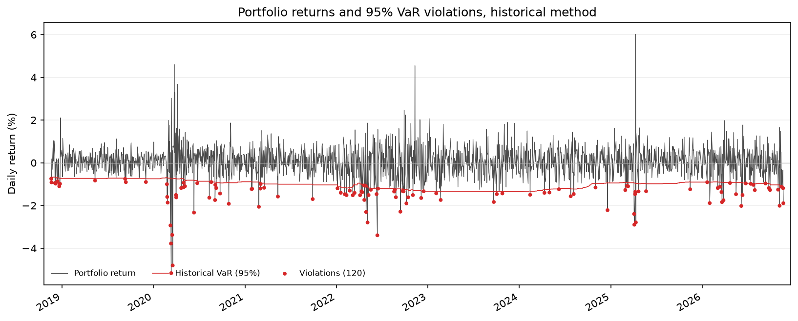
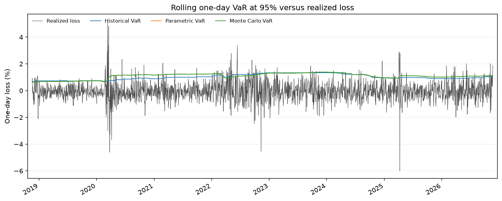

# Results

All figures are positive losses. The main backtest uses a 500-day window, a
95% confidence level and 100,000 Monte Carlo scenarios with seed 42. The
sample has 2,012 forecasts from 2018-11-19 to 2026-11-20. The expected number
of violations is 100.6.

The raw tables are in `docs/backtest_summary.csv`, `docs/sensitivity.csv` and
`docs/violations_by_year.csv`. The full per-day series is in
`docs/backtest_series.csv`.

## 1. Main backtest at 95%

| Method | Violations | Expected | Rate | Kupiec p | Christoffersen p | Conditional p |
|---|---:|---:|---:|---:|---:|---:|
| Historical | 120 | 100.6 | 5.96% | 0.0538 | 0.00168 | 0.00112 |
| Parametric | 114 | 100.6 | 5.67% | 0.1791 | 0.000497 | 0.000944 |
| Monte Carlo | 114 | 100.6 | 5.67% | 0.1791 | 0.000497 | 0.000944 |

Kupiec does not reject correct unconditional coverage for any method at the
5% level. The historical method is borderline at p = 0.0538 and its observed
rate is 5.96%. Christoffersen rejects independence for all three methods. The
joint conditional coverage test also rejects all three. The violations are
clustered in time.

The Monte Carlo and parametric rows are identical after rounding because both
models assume the same multivariate normal distribution. The largest absolute
difference between their daily VaR estimates is 0.000202 in return units, or
0.0202 percentage points. The violation flags differ on 2 of the 2,012 days.
Those differences do not change the totals or the transition counts.

## 2. Full-sample estimates

These are descriptive estimates on the 2,512 returns. They are not the
backtest.

| Method | VaR 95% | CVaR 95% |
|---|---:|---:|
| Historical | 1.031% | 1.574% |
| Parametric | 1.068% | 1.349% |
| Monte Carlo | 1.076% | 1.353% |

The empirical CVaR is 0.225 percentage points above the normal CVaR. The
empirical VaR is slightly lower than the normal VaR. This combination is what
a fat left tail looks like in this sample: the 5% quantile is close to the
normal one, while the average loss beyond it is larger.

## 3. Level 99%, 500-day window

| Method | Violations | Expected | Rate | Kupiec p | Christoffersen p | Conditional p |
|---|---:|---:|---:|---:|---:|---:|
| Historical | 24 | 20.1 | 1.19% | 0.3988 | 0.00227 | 0.00664 |
| Parametric | 40 | 20.1 | 1.99% | 8.64e-05 | 7.86e-05 | <1e-6 |
| Monte Carlo | 40 | 20.1 | 1.99% | 8.64e-05 | 7.86e-05 | <1e-6 |

At 99%, the normal model fails Kupiec badly. It produces almost twice the
expected number of violations. This is direct evidence that the normal tail is
too thin for this portfolio. The historical model gets the unconditional rate
closer and passes Kupiec at this window, but it still fails independence and
conditional coverage.

The Monte Carlo and parametric rows are identical because they share the same
normal model. The simulation adds noise, not a different tail.

## 4. Window sensitivity at 95%

| Window | Method | Violations | Expected | Rate | Kupiec p | Christoffersen p | Conditional p |
|---:|---|---:|---:|---:|---:|---:|---:|
| 250 | Historical | 139 | 113.1 | 6.15% | 0.01569 | 0.005293 | 0.001106 |
| 250 | Parametric | 132 | 113.1 | 5.84% | 0.07535 | 0.001611 | 0.001423 |
| 250 | Monte Carlo | 132 | 113.1 | 5.84% | 0.07535 | 0.001611 | 0.001423 |
| 500 | Historical | 120 | 100.6 | 5.96% | 0.0538 | 0.001684 | 0.001123 |
| 500 | Parametric | 114 | 100.6 | 5.67% | 0.1791 | 0.0004969 | 0.0009435 |
| 500 | Monte Carlo | 114 | 100.6 | 5.67% | 0.1791 | 0.0004969 | 0.0009435 |
| 750 | Historical | 111 | 88.1 | 6.30% | 0.01594 | 0.01042 | 0.002059 |
| 750 | Parametric | 96 | 88.1 | 5.45% | 0.3944 | 0.104 | 0.1856 |
| 750 | Monte Carlo | 96 | 88.1 | 5.45% | 0.3944 | 0.104 | 0.1856 |

The 750-day normal model is the only combination that passes Kupiec,
Christoffersen and conditional coverage at 95%. The 250-day and 500-day
normal models fail independence. The historical method fails independence at
every window. It fails Kupiec at 250 and 750 days and is borderline at 500
days.

This is a useful nuance. The 500-day independence failure is partly a
window-length problem for the normal model. A longer window reduces the
violation count and removes the clustering in this sample. But the longer
window reacts more slowly to regime changes, and it is chosen after looking at
the results. The 750-day pass is evidence, not a validated production choice.

## 5. Window sensitivity at 99%

| Window | Method | Violations | Expected | Rate | Kupiec p | Christoffersen p | Conditional p |
|---:|---|---:|---:|---:|---:|---:|---:|
| 250 | Historical | 31 | 22.6 | 1.37% | 0.09363 | 0.0005558 | 0.0006333 |
| 250 | Parametric | 55 | 22.6 | 2.43% | <1e-6 | 0.0002614 | <1e-6 |
| 250 | Monte Carlo | 55 | 22.6 | 2.43% | <1e-6 | 0.0002614 | <1e-6 |
| 500 | Historical | 24 | 20.1 | 1.19% | 0.3988 | 0.002271 | 0.006644 |
| 500 | Parametric | 40 | 20.1 | 1.99% | 8.642e-05 | 7.859e-05 | <1e-6 |
| 500 | Monte Carlo | 40 | 20.1 | 1.99% | 8.642e-05 | 7.859e-05 | <1e-6 |
| 750 | Historical | 25 | 17.6 | 1.42% | 0.09645 | 0.003866 | 0.003869 |
| 750 | Parametric | 35 | 17.6 | 1.99% | 0.0002443 | 0.004053 | 1.925e-05 |
| 750 | Monte Carlo | 35 | 17.6 | 1.99% | 0.0002443 | 0.004053 | 1.925e-05 |

At 99%, the normal model fails Kupiec at every window. The 750-day window does
not fix the tail. The historical model is much closer in unconditional terms
and passes Kupiec at 500 and 750 days, but it still fails independence. The
99% results are the clearest evidence that the normal assumption is
inadequate for this portfolio.

## 6. Violations by year, 95%, 500-day window

| Year | Obs. | Hist. viol. | Hist. rate | Param. viol. | Param. rate | MC viol. | MC rate |
|---:|---:|---:|---:|---:|---:|---:|---:|
| 2018 | 28 | 7 | 25.00% | 9 | 32.14% | 9 | 32.14% |
| 2019 | 252 | 4 | 1.59% | 5 | 1.98% | 5 | 1.98% |
| 2020 | 253 | 23 | 9.09% | 18 | 7.11% | 17 | 6.72% |
| 2021 | 252 | 8 | 3.17% | 6 | 2.38% | 6 | 2.38% |
| 2022 | 251 | 31 | 12.35% | 37 | 14.74% | 37 | 14.74% |
| 2023 | 250 | 5 | 2.00% | 5 | 2.00% | 5 | 2.00% |
| 2024 | 252 | 8 | 3.17% | 7 | 2.78% | 7 | 2.78% |
| 2025 | 250 | 11 | 4.40% | 11 | 4.40% | 11 | 4.40% |
| 2026 | 224 | 23 | 10.27% | 16 | 7.14% | 17 | 7.59% |

The 2018 row is partial, with only 28 forecasts from 2018-11-19. The 25% and
32% rates are based on a small sample and are not comparable with full years.
The 2026 row is also partial, through 2026-11-20.

The clustering is visible in 2020, 2022 and 2026. In 2022, the historical
method has 31 violations out of 251 forecasts, a 12.35% rate. The normal model
has 37, a 14.74% rate. In 2023 the rate is 2.00% for all methods. This pattern
is consistent with a fixed window that reacts slowly when volatility changes.
The yearly counts are descriptive, not a formal test.

## 7. Figures

Figure 1: daily portfolio returns and the rolling historical VaR at 95%. Red
dots mark the 120 violations. The VaR line is the negative of the positive VaR
estimate.

Figure 2: realized daily loss against the rolling VaR from the three methods.
The historical VaR is usually the lowest of the three. The parametric and Monte
Carlo lines are nearly identical.

## 8. What the results mean

- At 95% with a 500-day window, no method passes both coverage and
  independence. The normal models pass Kupiec but fail Christoffersen. The
  historical model is borderline on Kupiec and fails Christoffersen.
- At 99%, the normal model is clearly inadequate. It produces roughly twice
  the expected number of violations at every window. The historical model is
  closer on unconditional coverage but still clusters.
- The 750-day normal model passes all three tests at 95%. This suggests the
  independence failure at 500 days is partly a window-length problem. It does
  not rescue the model at 99%, and the window was selected after inspecting
  the results.
- The Monte Carlo method does not add model diversity. It is the same normal
  model as the parametric method, with simulation noise.
- The results do not support a claim that any of the three methods is adequate
  at both 95% and 99%. The honest conclusion is that the portfolio has a
  fat-tailed loss distribution, and a fixed-window normal model underestimates
  the tail.
