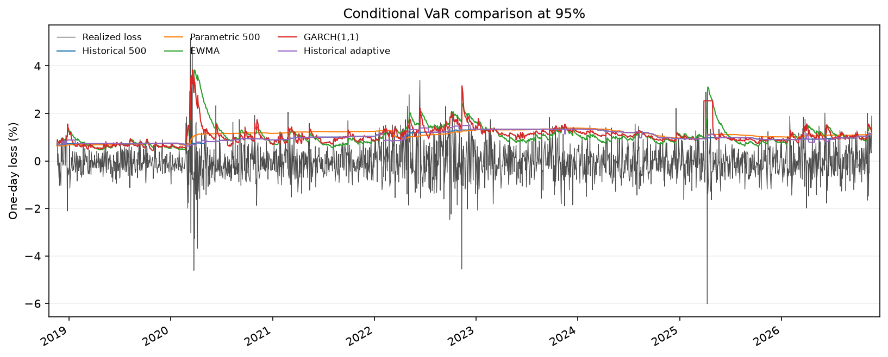
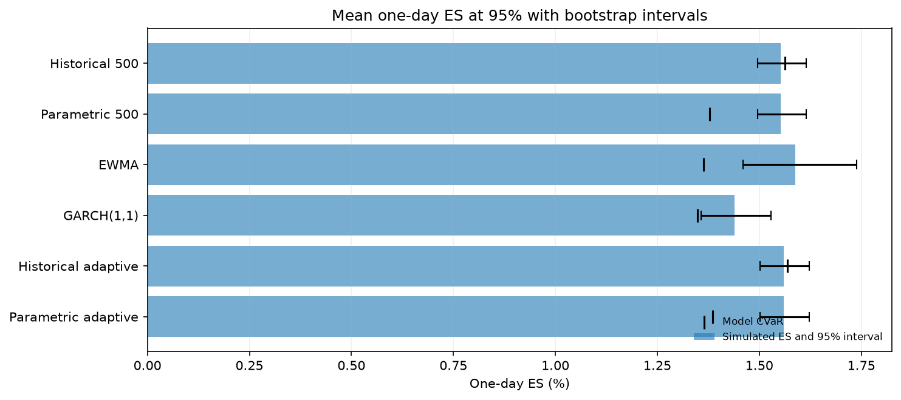

# Conditional volatility comparison

The protocol for this comparison was written before the results in
[`docs/methodology.md`](methodology.md), section 10, dated 2026-11-23. The
model list, the adaptive rule, the GARCH settings, the loss function, the
Diebold-Mariano lags, the bootstrap settings, the stress years and the winner
rule were fixed in that section. The previous 750-day sensitivity result
remains exploratory and was not used to choose the winner.

The evaluation period is the same 2,012 one-day forecasts from 2018-11-19 to
2026-11-20. Every model uses only data available before the forecast date.

The results below are tied to the frozen `data/prices.csv` snapshot. The
dated fresh-data comparison is in
[`docs/results_fresh.md`](results_fresh.md).

## 95% results

| Model | Violations | Expected | Rate | Kupiec p | Christoffersen p | Conditional p | Mean loss (bp) | Rank |
|---|---:|---:|---:|---:|---:|---:|---:|---:|
| GARCH(1,1) | 102 | 100.6 | 5.07% | 0.8864 | 0.3916 | 0.6858 | 7.83 | 1 |
| EWMA | 102 | 100.6 | 5.07% | 0.8864 | 0.9729 | 0.9893 | 8.08 | 2 |
| Historical 500 | 120 | 100.6 | 5.96% | 0.0538 | 0.00168 | 0.00112 | 8.59 | 3 |
| Parametric adaptive | 109 | 100.6 | 5.42% | 0.3963 | 0.00617 | 0.01642 | 8.62 | 4 |
| Historical adaptive | 116 | 100.6 | 5.77% | 0.1237 | 0.00255 | 0.00323 | 8.63 | 5 |
| Parametric 500 | 114 | 100.6 | 5.67% | 0.1791 | 0.000497 | 0.000944 | 8.63 | 6 |

The mean loss is the average quantile loss over the 2,012 forecasts, in basis
points of portfolio value. The rank is the pre-registered ranking by mean loss.

### Winner rule at 95%

GARCH(1,1) has the lowest mean quantile loss and EWMA is second. The
Holm-adjusted Diebold-Mariano p-value for GARCH against EWMA is 0.7039. The
pre-registered rule requires a value below 0.05 for a clear winner. The
decision is:

**No clear winner between GARCH(1,1) and EWMA.**

GARCH and EWMA both pass Kupiec, Christoffersen and conditional coverage at
95%. The fixed and adaptive historical and parametric models fail independence.
Conditional volatility fixes the independence failure, but the data do not
distinguish GARCH from EWMA.

## 99% results

| Model | Violations | Expected | Rate | Kupiec p | Christoffersen p | Conditional p | Mean loss (bp) | Rank |
|---|---:|---:|---:|---:|---:|---:|---:|---:|
| GARCH(1,1) | 36 | 20.12 | 1.79% | 0.00136 | 0.1566 | 0.00217 | 2.38 | 1 |
| EWMA | 42 | 20.12 | 2.09% | 0.000019 | 0.0669 | 0.000020 | 2.56 | 2 |
| Historical adaptive | 27 | 20.12 | 1.34% | 0.1429 | 0.00427 | 0.00577 | 2.92 | 3 |
| Historical 500 | 24 | 20.12 | 1.19% | 0.3988 | 0.00227 | 0.00664 | 3.03 | 4 |
| Parametric 500 | 40 | 20.12 | 1.99% | 0.000086 | 0.000079 | <1e-6 | 3.09 | 5 |
| Parametric adaptive | 40 | 20.12 | 1.99% | 0.000086 | 0.000840 | 0.000002 | 3.12 | 6 |

### Winner rule at 99%

GARCH(1,1) has the lowest mean quantile loss and EWMA is second. The
Holm-adjusted p-value is 1.0000. The decision is:

**No clear winner between GARCH(1,1) and EWMA.**

This is not a good result for the normal conditional models. GARCH and EWMA
produce 36 and 42 violations against 20.1 expected. They fail Kupiec at 99%.
The historical models are closer on unconditional coverage but fail
independence. No model passes both tests at 99%. Conditional volatility alone
does not fix the thin normal tail.

## Expected Shortfall at 95%

The model CVaR is the empirical tail mean for the historical models and the
normal closed-form ES for the parametric models. The simulated ES is filtered
historical simulation with 10,000 draws. The interval is a moving block
bootstrap of the daily ES series with block length 20 and 10,000 resamples.

| Model | CVaR type | Mean CVaR | CVaR 95% CI | Mean simulated ES | ES 95% CI |
|---|---|---:|---|---:|---|
| Historical 500 | empirical | 1.5635% | [1.5060%, 1.6253%] | 1.5531% | [1.4961%, 1.6146%] |
| Parametric 500 | parametric | 1.3778% | [1.3302%, 1.4286%] | 1.5531% | [1.4961%, 1.6146%] |
| EWMA | parametric | 1.3629% | [1.2613%, 1.4807%] | 1.5888% | [1.4608%, 1.7381%] |
| GARCH(1,1) | parametric | 1.3492% | [1.2733%, 1.4363%] | 1.4394% | [1.3578%, 1.5288%] |
| Historical adaptive | empirical | 1.5691% | [1.5109%, 1.6324%] | 1.5594% | [1.5018%, 1.6222%] |
| Parametric adaptive | parametric | 1.3861% | [1.3366%, 1.4398%] | 1.5594% | [1.5018%, 1.6222%] |

The historical and parametric models share the same simulated ES when they
share the same window and residuals. The difference is in the model CVaR, which
is empirical for the historical model and normal for the parametric model.

GARCH has the lowest point estimate of the model CVaR and of the simulated ES.
The CVaR columns are not the same estimator across rows: the historical models
use an empirical tail mean and the normal models use the closed-form normal
tail mean. The bootstrap intervals overlap with EWMA and the historical models
at 95%. The lower point estimate is not statistically separated from the
alternatives.

## Expected Shortfall at 99%

| Model | CVaR type | Mean CVaR | CVaR 99% CI | Mean simulated ES | ES 99% CI |
|---|---|---:|---|---:|---|
| Historical 500 | empirical | 2.6277% | [2.4694%, 2.8029%] | 2.5492% | [2.3993%, 2.7170%] |
| Parametric 500 | parametric | 1.7916% | [1.7303%, 1.8567%] | 2.5492% | [2.3993%, 2.7170%] |
| EWMA | parametric | 1.7610% | [1.6297%, 1.9132%] | 2.3208% | [2.1239%, 2.5498%] |
| GARCH(1,1) | parametric | 1.7545% | [1.6570%, 1.8672%] | 2.0611% | [1.9412%, 2.1943%] |
| Historical adaptive | empirical | 2.6071% | [2.4491%, 2.7874%] | 2.5382% | [2.3860%, 2.7112%] |
| Parametric adaptive | parametric | 1.8015% | [1.7381%, 1.8700%] | 2.5382% | [2.3860%, 2.7112%] |

The GARCH simulated ES interval at 99% overlaps the EWMA interval and sits
below the two historical intervals, which do not overlap it. This does not
make GARCH the better risk model in this sample: GARCH fails Kupiec at 99%
with 36 violations against 20.1 expected. A lower simulated tail mean with too
many VaR violations is a sign of a model that still has the wrong tail shape,
not a model that dominates.

## Stress years at 95%

### 2020

| Model | Violations | Observations | Rate | Mean loss (bp) |
|---|---:|---:|---:|---:|
| GARCH(1,1) | 16 | 253 | 6.32% | 12.10 |
| EWMA | 14 | 253 | 5.53% | 13.12 |
| Parametric adaptive | 16 | 253 | 6.32% | 14.59 |
| Parametric 500 | 18 | 253 | 7.11% | 14.71 |
| Historical 500 | 23 | 253 | 9.09% | 15.22 |
| Historical adaptive | 23 | 253 | 9.09% | 15.34 |

### 2022

| Model | Violations | Observations | Rate | Mean loss (bp) |
|---|---:|---:|---:|---:|
| EWMA | 17 | 251 | 6.77% | 10.66 |
| GARCH(1,1) | 21 | 251 | 8.37% | 10.69 |
| Historical 500 | 31 | 251 | 12.35% | 10.87 |
| Historical adaptive | 28 | 251 | 11.16% | 11.19 |
| Parametric 500 | 37 | 251 | 14.74% | 11.33 |
| Parametric adaptive | 33 | 251 | 13.15% | 11.65 |

### 2026, through 2026-11-20

| Model | Violations | Observations | Rate | Mean loss (bp) |
|---|---:|---:|---:|---:|
| Parametric adaptive | 19 | 224 | 8.48% | 8.45 |
| Parametric 500 | 16 | 224 | 7.14% | 8.48 |
| Historical 500 | 23 | 224 | 10.27% | 8.75 |
| GARCH(1,1) | 18 | 224 | 8.04% | 8.76 |
| Historical adaptive | 23 | 224 | 10.27% | 8.76 |
| EWMA | 17 | 224 | 7.59% | 8.86 |

The regime ranking is mixed. GARCH is best in 2020, EWMA is best in 2022, and
the parametric models are best in 2026. No single model dominates all three
stress years.

## Diebold-Mariano

The full 15-pair table for each level is in
[`docs/conditional_dm.csv`](conditional_dm.csv). The key comparisons at 95%:

| Comparison | Mean loss difference (bp) | DM statistic | Raw p | Holm p |
|---|---:|---:|---:|---:|
| EWMA vs GARCH | 0.25 | 1.852 | 0.064 | 0.704 |
| Historical 500 vs GARCH | 0.76 | 2.094 | 0.036 | 0.435 |
| Parametric 500 vs GARCH | 0.80 | 2.289 | 0.022 | 0.309 |
| Historical 500 vs EWMA | 0.51 | 1.553 | 0.120 | 0.843 |

The raw p-values for GARCH against the fixed models are below 0.05, but the
Holm adjustment over 15 comparisons raises them to 0.31 and 0.44. The GARCH
advantage is not significant after multiple-testing correction.

At 99%, GARCH vs EWMA has a mean loss difference of 0.18 bp, DM statistic
1.581, raw p = 0.114 and Holm p = 1.000.

## Honest conclusion

- At 95%, conditional volatility fixes the independence failure. GARCH and
  EWMA pass Kupiec, Christoffersen and conditional coverage. The fixed and
  adaptive historical and parametric models fail independence.
- GARCH has the lowest mean quantile loss at 95% and 99%, and the lowest mean
  ES at 95%. The pre-registered winner rule still returns no clear winner
  because the Holm-adjusted difference against EWMA is not significant.
- The adaptive window does not fix the independence failure. The adaptive
  historical model has 116 violations against 120 for the fixed window. The
  adaptive parametric model has 109 against 114. Both still fail independence.
  Their mean losses are essentially the same as the fixed models.
- At 99%, normal conditional volatility is not enough. GARCH and EWMA fail
  Kupiec. The historical models are closer on unconditional coverage but fail
  independence. No model passes both.
- The ES intervals overlap at 95%. At 99%, GARCH has a lower simulated ES than
  EWMA, but its VaR coverage is worse. The lower ES is not evidence of a better
  risk model.
- The stress-year ranking is mixed: GARCH in 2020, EWMA in 2022, parametric in
  2026.
- The result is **no clear winner**. The evidence supports conditional
  volatility as a fix for the 95% independence problem, but not as a uniquely
  superior model and not as a fix for the 99% tail.

## Figures

Figure 3: realized loss and the main conditional VaR models at 95%.

Figure 4: mean simulated ES at 95% with block-bootstrap intervals. The black
markers are the model CVaR.

## Files

- `docs/conditional_summary.csv`
- `docs/conditional_dm.csv`
- `docs/conditional_stress.csv`
- `docs/conditional_es.csv`
- `docs/conditional_series_95.csv`
- `docs/fig3_conditional_var.png`
- `docs/fig4_es_ci.png`
